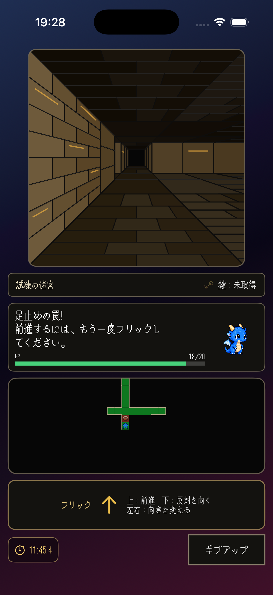

# 日専祭アプリ
> -  チーム名: Aチーム 
> -  メンバー: 26cm0130三浦崇志、26cm0120竹岡修一、26cm0101安住光司 
> -  AI利用レベル： 2（生成コード可） 
> -  最終更新： 2026-10-19 
> -  チーム： Aチーム（26CM0101安住光司、26CM0120竹岡修一、26CM0130三浦崇志） 
---

## 何ができるアプリか（3行）
> - 名称：What's gathered? Run!（ワギャラン） 
> - 内容：ウィーザードリーのゲームを楽しめるアプリ 
> - 特色：フリックなどスマホならではの操作感

## 画面
 

## 使った文法・技術

（例：`@State`、`List`、`ForEach`、構造体、配列の `append` と `remove`）

## 生成AIの使い方（どの場面で、どう使ったか）
> - GitHubの使い方（コマンドや機能の意味など）
> - 罠の機能の骨組み
> - コードのリファクタリング

## 展示で工夫した点

（例：文字を大きくして、来場者が操作しやすいようにした。） 
(仮)端末を設置する背景を迷路の絵にしてアプリ内容のイメージをしやすくした
